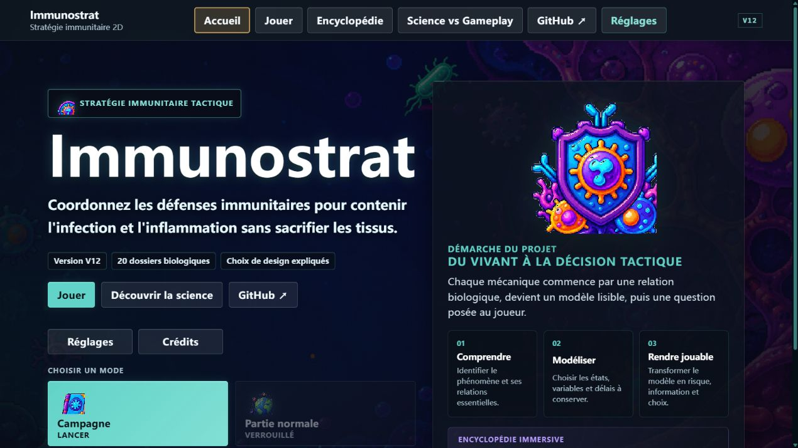
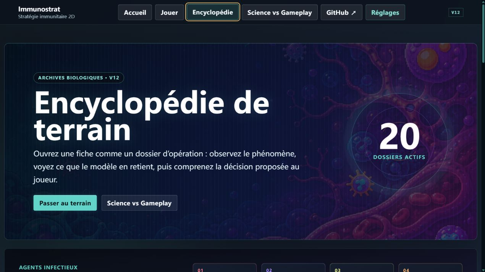
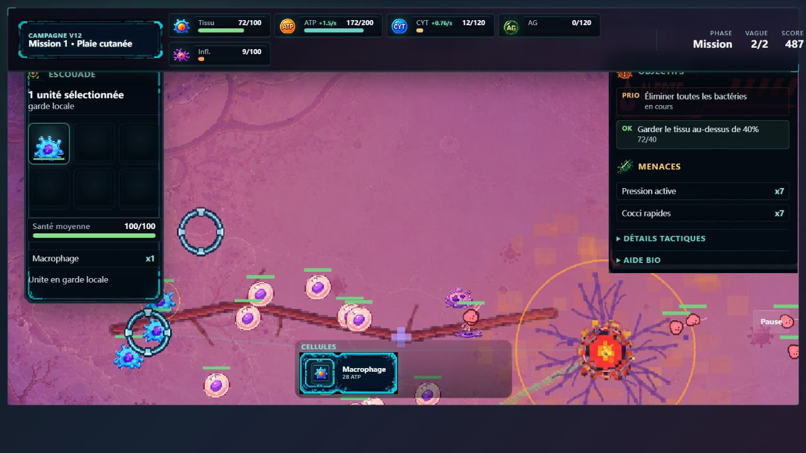
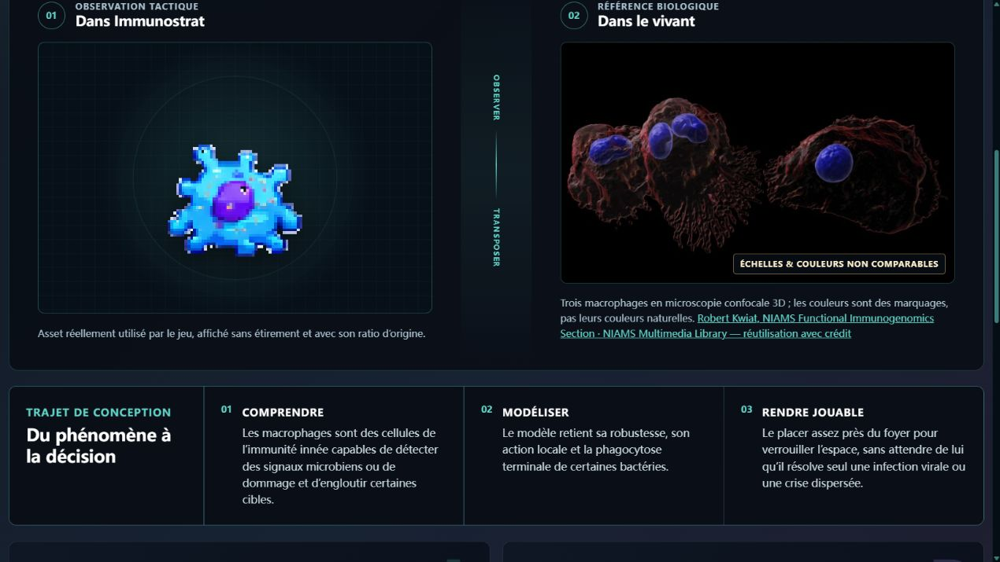
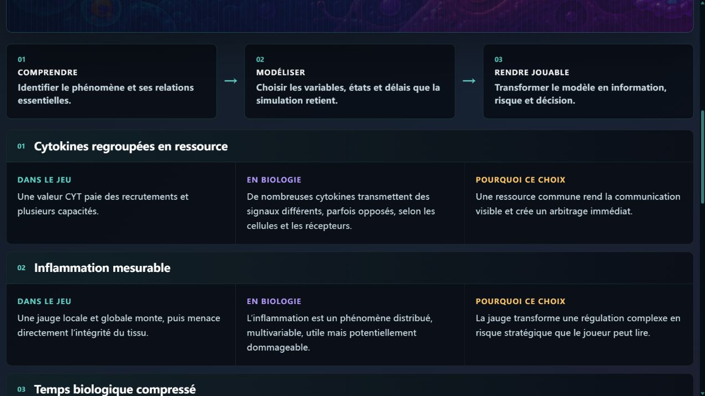

# Immunostrat

**Immunostrat** est un jeu de stratégie 2D jouable dans le navigateur. Le
joueur coordonne les défenses immunitaires pour contenir l'infection et
l'inflammation sans sacrifier les tissus.

**[Jouer à Immunostrat](https://oopslurp.github.io/immunostrat/)** ·
**[Explorer l'encyclopédie](https://oopslurp.github.io/immunostrat/#/encyclopedia)** ·
**[Science vs Gameplay](https://oopslurp.github.io/immunostrat/#/science-vs-gameplay)**

La V12 prolonge directement la dernière version du jeu et conserve ses systèmes,
animations, correctifs, simulation et équilibrage. Elle expose le projet, ses
contenus biologiques et les choix qui relient observation scientifique et
décision de jeu.

> Immunostrat est une œuvre ludique et une simplification pédagogique. Il ne
> constitue ni un modèle médical, ni une source de conseil ou de diagnostic.

## L'intention de conception

Chaque système suit la même démarche, visible sans interrompre l'expérience :

1. **Comprendre un phénomène biologique** — identifier les relations et
   contraintes qui donnent son sens au phénomène.
2. **Décider comment le modéliser** — choisir les états, variables, délais et
   interactions à conserver.
3. **Décider comment le rendre jouable** — transformer ce modèle en
   information, risque et choix tactique.

L'inflammation en est l'exemple central : dans le vivant, elle recrute et
coordonne, mais peut aussi léser le tissu. Dans le modèle, elle devient une
ressource locale avec seuils et délais. Pour le joueur, elle ouvre alors un
arbitrage permanent entre vitesse d'intervention et dommages collatéraux.

## Captures choisies comme tutoriel

Ces cinq captures proviennent de la version finale, sans maquette ni écran de
debug. Chacune répond à une question précise au lieu de servir de simple vitrine.

### 1 — Quelle est la promesse du projet ?



L'accueil place au même niveau l'action de jouer, les archives biologiques et la
démarche « comprendre → modéliser → rendre jouable ». Le visiteur sait ainsi que
le projet est à la fois un jeu complet et un travail de conception documenté.

### 2 — Quelles menaces le modèle distingue-t-il ?



L'entrée de l'encyclopédie annonce 20 dossiers et isole immédiatement les quatre
familles infectieuses. Les cellules anormales et infections opportunistes sont
gardées à part pour ne pas fabriquer une fausse taxonomie.

### 3 — Que faut-il lire avant d'agir ?



Le macrophage est sélectionné, le tissu est déjà entamé et sept menaces sont
actives. HUD, objectifs et terrain forment une même leçon : vérifier l'intégrité
du tissu et la pression ennemie avant de donner un ordre de déplacement ou
d'attaque.

### 4 — Comment une unité jouable se relie-t-elle au vivant ?



La fiche met en parallèle le sprite animé et une microscopie confocale créditée.
Le raccord n'est jamais présenté comme une équivalence d'échelle ou de couleur :
il ouvre sur ce qui a été compris, conservé dans le modèle puis transformé en
responsabilité tactique.

### 5 — Où les simplifications sont-elles expliquées ?



Chaque comparaison sépare **Dans le jeu**, **En biologie** et **Pourquoi ce
choix**. Les écarts ne sont donc pas cachés : ils documentent les simplifications
nécessaires à la lisibilité et à la prise de décision.

## Encyclopédie immersive

L'encyclopédie contient 20 dossiers reliés entre eux : cellules immunitaires,
signaux, structures, agents infectieux et états du tissu. Chaque fiche présente
le rôle dans le jeu, la biologie simplifiée, les aspects conservés et les
simplifications de gameplay.

Les quatre familles infectieuses réellement représentées sont distinguées :

- **bactéries** — essaims, prolifération, résistance et biofilm ;
- **virus** — particule libre, cellule infectée et propagation ;
- **champignons** — foyers persistants, croissance et spores ;
- **parasites** — profils massifs, mobiles ou migrateurs.

Les **cellules anormales** sont présentées séparément comme une menace interne,
pas comme un pathogène. Les **infections opportunistes** décrivent un contexte
hôte-agent, pas une cinquième famille taxonomique.

Pour les macrophages et neutrophiles, le sprite du jeu est placé face à une
image microscopique. Les agents infectieux sont comparés à un exemple réel de
leur famille. Les fiches sans image exacte refusent explicitement d'inventer une
« vraie photo ». Toutes les sources figurent dans
[docs/BIOLOGICAL_IMAGE_CREDITS.md](docs/BIOLOGICAL_IMAGE_CREDITS.md). Les
notions biologiques générales sont reliées dossier par dossier à des références
NIH, NCBI, NIAID, NCI et CDC dans
[docs/BIOLOGICAL_REFERENCES.md](docs/BIOLOGICAL_REFERENCES.md).

## Modes de jeu

- **Campagne** : missions progressives, du macrophage aux réponses adaptatives.
- **Partie normale** : arbitrage stratégique entre plusieurs régions du corps.
- **Carte du corps** : suivi des foyers actifs et envoi de renforts.
- **Mode infini** : vagues et menaces de difficulté croissante.

La campagne principale introduit d'abord bactéries et virus. Les familles
avancées apparaissent dans la carte du corps et les missions infinies.

## Commandes

- clic gauche : sélectionner une unité ou tracer une sélection multiple ;
- clic gauche sur le terrain ou une cible : donner un ordre ;
- clic droit maintenu : déplacer la caméra ;
- `WASD` ou `ZQSD` : déplacer la caméra.

Les actions disponibles, leurs coûts et les retours tactiques sont également
affichés dans l'interface de combat.

## Architecture

React porte les pages publiques et les HUD ; Phaser gère le champ de bataille.
La simulation reste indépendante du rendu, ce qui permet de tester les règles
sans démarrer le moteur graphique. Les routes publiques utilisent le hash afin
de rester rechargeables sur GitHub Pages.

- `src/app` : routes, navigation et shell React ;
- `src/pages` : accueil, sélection de mode, encyclopédie et HUD ;
- `src/components/encyclopedia` : comparaison sprite/vivant et visualisation ;
- `src/content` : dossiers scientifiques structurés et liens aux profils réels ;
- `src/game/phaser` : scènes, rendu, animations et entrées ;
- `src/game/simulation` : simulation déterministe indépendante du rendu ;
- `src/game/data` : missions, unités, menaces et équilibrage ;
- `src/game/bodyMap` et `src/game/infinite` : modes stratégiques ;
- `public/assets` : sprites et ressources servies sans transformation ;
- `src/tests` : tests de simulation, intégration et cohérence éditoriale ;
- `docs` : décisions techniques, audits et crédits.

Les six unités disposant de spritesheets sont affichées sans étirement et avec
leur grille d'animation réelle. Les menaces qui n'ont pas de spritesheet restent
rendues par le système procédural existant ; ce fallback est volontairement
préservé.

## Stack technique

- React 19 et React DOM 19 ;
- Phaser 3.90 ;
- TypeScript 5.9 ;
- Vite 7 ;
- Vitest 3.

Aucun compte, serveur applicatif, analytics ou base de données distante n'est
utilisé. La progression et les records restent dans le `localStorage` du
navigateur.

## Installation locale

Node.js 20.19 ou plus récent est requis.

```bash
git clone https://github.com/Oopslurp/immunostrat.git
cd immunostrat
npm ci
npm run dev
```

Vite affiche l'adresse locale à ouvrir dans le navigateur.

## Vérification et build

```bash
npm run test    # suite Vitest
npm run build   # TypeScript puis build de production
npm run preview # aperçu local du dossier dist
```

Le dossier `dist/` est généré et ne doit pas être commité.

## Déploiement GitHub Pages

Le workflow `.github/workflows/deploy-pages.yml` installe les dépendances,
exécute les tests, construit puis déploie le site après chaque push sur `main`.
Les pull requests exécutent la même validation sans publier. Le `base: "./"` de
Vite et les routes hash rendent le build compatible avec un site de projet
`https://<compte>.github.io/<depot>/`.

## Accessibilité et confidentialité

- navigation clavier et focus visibles sur les surfaces publiques ;
- animations décoratives neutralisées avec `prefers-reduced-motion` ;
- textes alternatifs et crédits sur les images biologiques ;
- mise en page responsive ;
- aucun compte, cookie distant ou secret requis.

Consultez [SECURITY.md](SECURITY.md) pour signaler une vulnérabilité. Ne placez
jamais de jeton, mot de passe ou fichier `.env` dans le dépôt.

## Crédits

- conception, direction et sélection des assets : **Mathieu C. / Oopslurp** ;
- ressources visuelles originales générées avec **ChatGPT**, puis sélectionnées
  et intégrées pour Immunostrat ;
- assistance au développement : **OpenAI Codex** ;
- micrographies : **NIAMS Multimedia Library** et **CDC Public Health Image
  Library**, avec crédits détaillés dans
  [docs/BIOLOGICAL_IMAGE_CREDITS.md](docs/BIOLOGICAL_IMAGE_CREDITS.md) ;
- moteur et interface : Phaser, React et React DOM — voir
  [THIRD_PARTY_NOTICES.md](THIRD_PARTY_NOTICES.md).

## Licence

Le code et les ressources originales d'Immunostrat sont distribués sous licence
MIT, copyright 2026 Mathieu C. Consultez [LICENSE](LICENSE). Les images
biologiques et composants tiers restent soumis aux conditions indiquées dans
[THIRD_PARTY_NOTICES.md](THIRD_PARTY_NOTICES.md).
